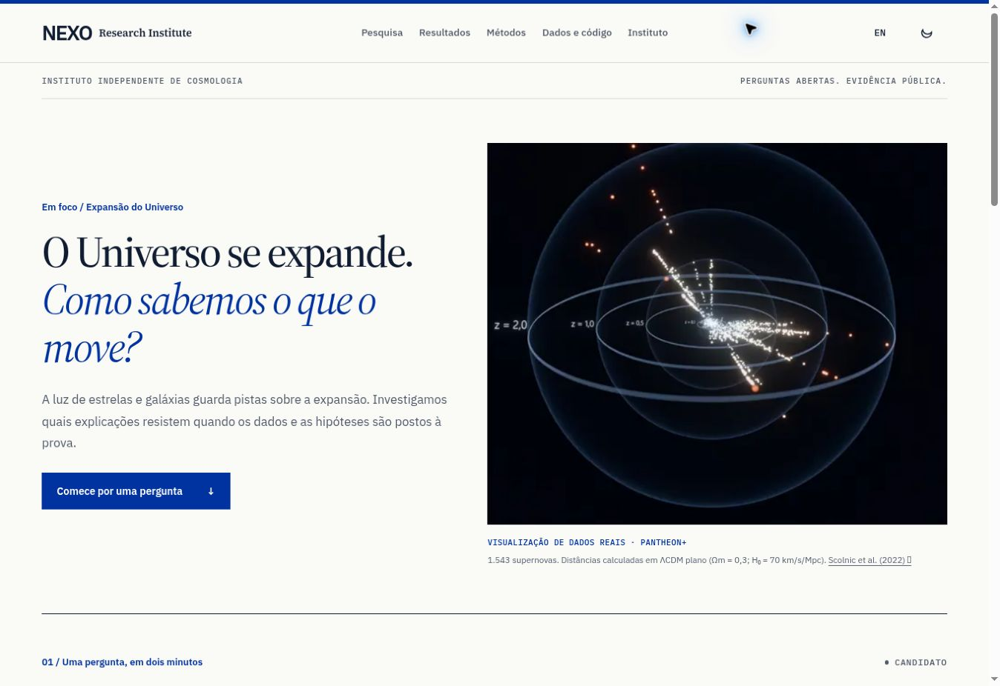
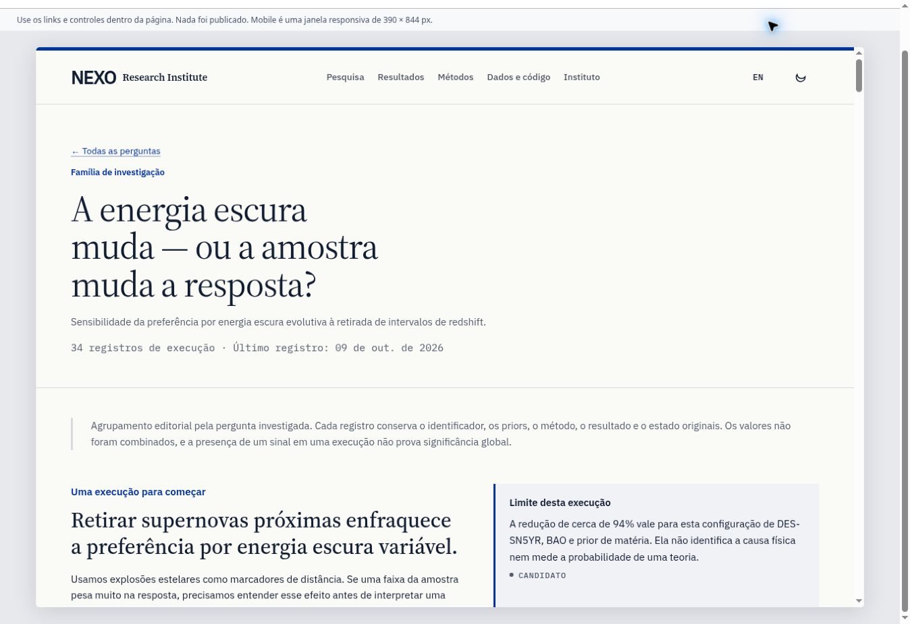
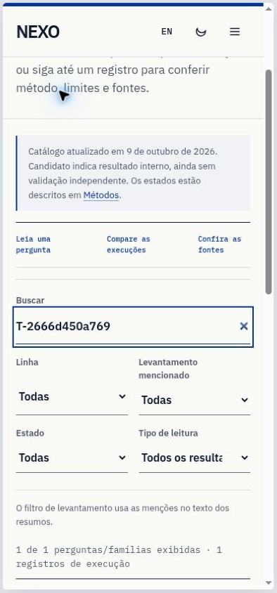

# Rework editorial — 15/11/2026

Implementação local, sem publicação. Base: `4a0e58b`. Branch: `rework/editorial-20261115`.

## Percurso

Home → pergunta em destaque → registro com conclusão e limite → condições do teste → dossiê, dados e código.

Pesquisa → pergunta física → catálogo filtrado → família → execução individual.

A home seleciona quatro leituras. O catálogo mantém as 35 famílias e os 169 registros autorizados, com busca pelos identificadores e pelo vocabulário técnico original. O resultado negativo destacado é um eixo separado do estado científico: continua `CANDIDATE`.

## Alterações

- Hierarquia editorial com serifas, fundo claro, azul `#0033A0`, tema escuro preservado.
- Visualização Pantheon+ com identificação de dados reais, cosmologia assumida e fonte.
- Contagens saem da entrada; pergunta, conclusão, contexto e limite aparecem antes dos dados operacionais.
- Contexto de leitura para todas as famílias atuais, com quatro leituras curadas completas.
- Fonte científica, IDs, números, pertinência às famílias, estados e dossiês preservados.
- PT/EN e rotas anteriores mantidos. Perguntas sem registros públicos têm filtro de contagem zero.

## Verificação

- `npm run check`: 36 testes, tipagem, regeneração do manifesto e varredura de material privado aprovados.
- `npm run build`: 440 páginas geradas.
- Fonte: 169 registros, 71 figuras, 0 aprovações, 3 dossiês.
- Busca pela pergunta, identificação de resultado negativo, detalhe com método e fontes verificados pela interface.
- Pesquisa → catálogo filtrado → família → execução → troca PT/EN no mesmo registro verificados. Busca mobile pelo ID `T-2666d450a769` retorna a pergunta em linguagem clara. Tema escuro e retorno à família funcionam.
- Revisão responsiva em janelas de 1240 e 390 px. Isso verifica layout e interação; não substitui teste em aparelho físico.
- `data/source` e os dossiês científicos não foram modificados. `data/curated/pages.json` registra apenas a revisão editorial das páginas.

## Preview

Individual: `npm ci`, `npm run build`, `npm run dev` na raiz.

Conjunto com Cosmos: veja [review/README.md](../../review/README.md). O painel permite alternar site, percurso e largura sem publicar.

## Capturas

| Desktop | Mobile, 390 px |
| --- | --- |
|  |  |
|  |  |

As versões `*-detail.jpg` recortam apenas a moldura do preview. As capturas completas também estão no diretório.
